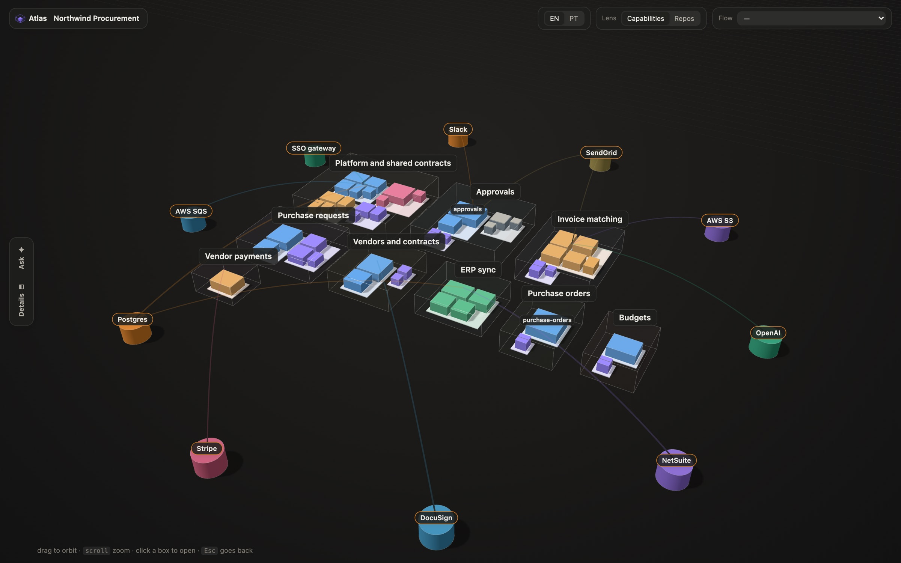
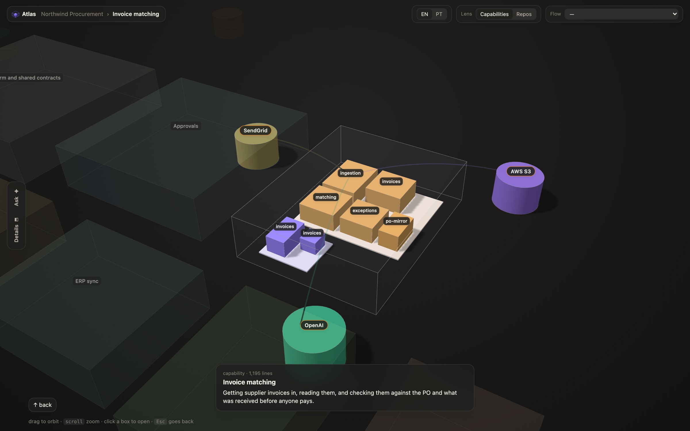
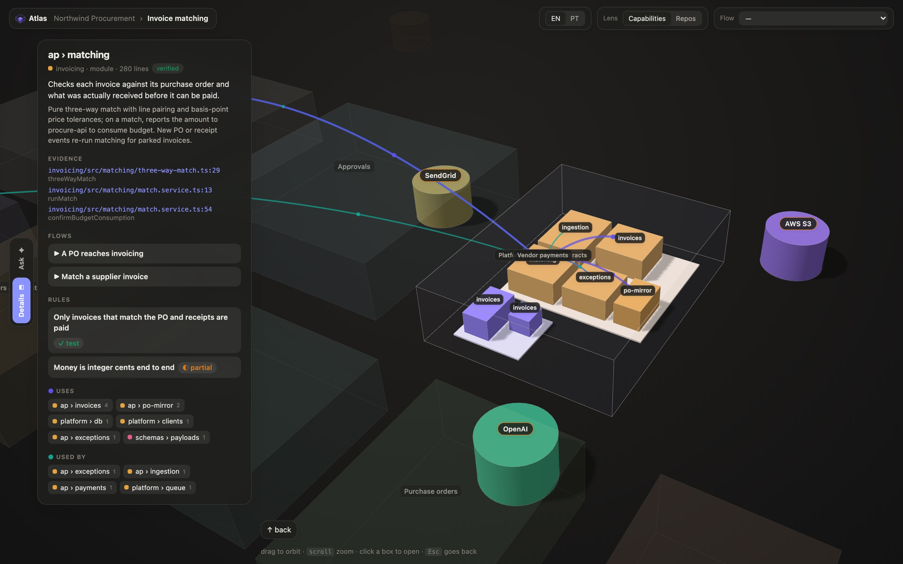
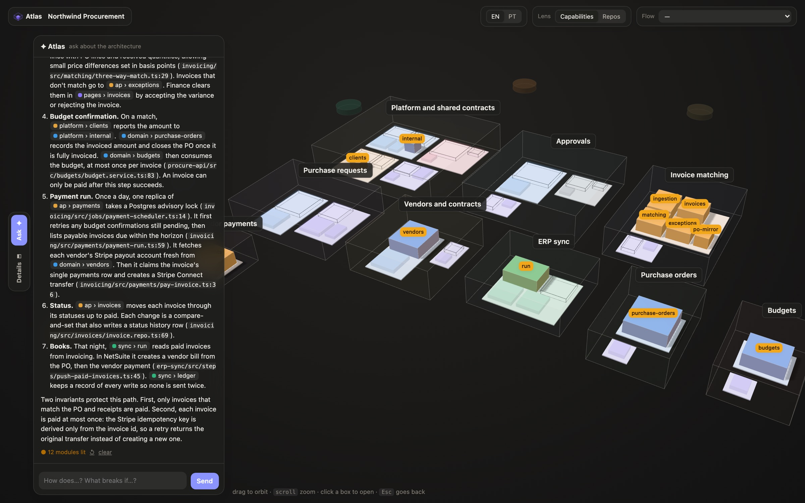

<p align="center"></p>

# Atlas

A living, semantic, 3D map of a codebase, written and kept current by the coding agent that already works in it.

Code written by agents makes the architecture harder to hold in your head. You stop knowing which services exist, how they talk, and what a module is _for_. A dependency graph shows the structure and loses the meaning. A generated wiki reads like API docs and goes stale.

Atlas keeps both layers:

- a deterministic skeleton of modules, imports and hashes, which serves as evidence;
- a semantic layer on top of it, anchored to `file:line`, that says what each part does and records the flows, the rules that must hold, and the decisions behind them.



> **Status: prototype.** Works with Claude Code.

## Install

In Claude Code:

```
/plugin install atlas --marketplace pedrobrun/atlas
```

Then, in any project:

```
/atlas:atlas
```

Atlas needs Node 24 or later. There is nothing to `npm install`.

## What happens

**The first time**, the agent maps the project:

1. It reads the repos and writes `.atlas/atlas.config.json`, which says how files group into modules.
2. It reads the code and writes `.atlas/semantic.json` with capabilities, a description of every module, the main flows, rules and decisions.
3. It checks both against the code until the build is clean.
4. It opens the map at `http://127.0.0.1:4317`.

**After that, the map maintains itself:**

- **When a session starts**, the agent gets a short brief of the map and the path to the full one. It reads the full map before changing an area it doesn't know.
- **When the agent changes the architecture**, it updates `semantic.json` in the same change. The brief tells it to.
- **When a turn ends**, the skeleton is rebuilt. Module descriptions whose code changed are marked out of date and rewritten in the background.

Run `/atlas:atlas` again to open the map. Add `status` to see what is out of date, or `refresh` to rewrite those descriptions now.

**In the map:**

- Click a box to open it, and press Esc to go back up one level.
- External systems (databases, queues, SaaS and AI APIs) ring the code, each linked to the code that calls it. Open a capability or a module and the systems it talks to dock beside it.
- Ask the side chat about the architecture. It lights up the modules it is talking about.
- Ask it to document a flow, and it traces the flow in the code for you to save.

The chat and the descriptions run your own Claude Code (`claude -p`) with read-only tools, so there is no API key to set up.

## Example

[`examples/procurement`](examples/procurement) is a made-up company's procurement system. It has six services and nine external systems, and its flows cross all of them. Its map in `examples/procurement/.atlas/` was written by `/atlas:atlas` alone, in one run. To open it from a clone:

```sh
node src/cli.ts open examples/procurement
```

Opening a capability brings the systems it talks to next to it:



Details shows what a module is for, the lines that prove it, the flows and rules it takes part in, and what it uses and what uses it:



Ask answers from the map and the code. It cites modules and lines, and lights up the modules it talks about:



## The project folder

A project is any folder holding one or more git repos. Its map lives with it, never with the tool. You can put it in a single repo, at a workspace root above several repos, or in one "home" repo that describes its siblings.

```
<project>/
  .atlas/
    atlas.config.json        # how files group into modules, and which external systems to look for
    semantic.json            # what they mean: capabilities, descriptions, flows, rules, decisions
    descriptions.local.json  # descriptions the agent rewrote or wrote on first visit
    flows.local.json         # flows saved from the chat
    out/                     # generated, gitignore it
  web/        (a git repo)
  billing/    (a git repo)
```

The agent writes these files, and you can edit them too. The formats are in [`skills/atlas/SKILL.md`](skills/atlas/SKILL.md) (the config) and [`skills/atlas/semantic-format.md`](skills/atlas/semantic-format.md) (the semantic layer). Every id is checked against the code on each build, and a wrong one fails with the field named.

## Without the plugin

The same commands the agent runs:

```sh
node src/cli.ts open [dir]      # build, start the local server, open the browser
node src/cli.ts build [dir]     # rebuild .atlas/out/
node src/cli.ts status [dir]    # what is described, what is out of date
node src/cli.ts refresh [dir]   # rewrite out-of-date descriptions
```

## Known limits

- A chat answer takes about 1 to 3 minutes, because each question is a full Claude Code session. Describing a module on its first visit takes 45 to 90 seconds.
- At most 8 descriptions are rewritten after a turn. Run `refresh` for the rest.
- Labels can overlap in dense areas, and arcs to far modules leave the screen.
- Not built yet: an architecture diff per branch or PR, a hosted view, and agents other than Claude Code.

Working on Atlas itself? See [CONTRIBUTING.md](CONTRIBUTING.md).
